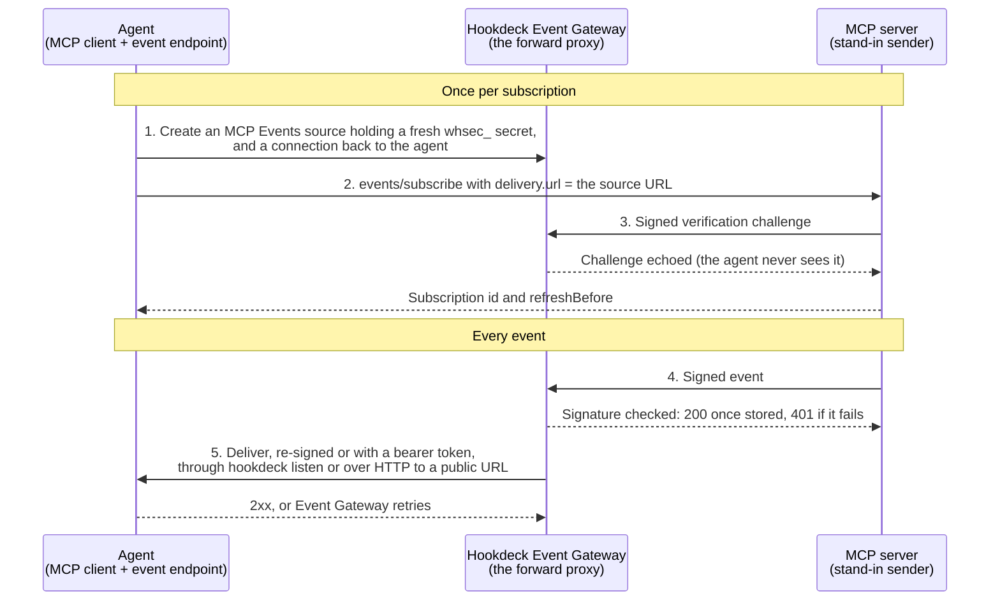

# Receive MCP Events with Event Gateway as a forward proxy

**Status:** demo code, not production-ready. Verified on 2026-10-08 and 2026-10-09 against a dedicated Event Gateway test project: locally through `hookdeck listen`, deployed on Fly.io, and with two different MCP servers sending. Re-run on 2026-10-14 after Event Gateway's MCP Events handshake changes: 7 of 7 scenarios locally, 6 of 6 deployed. Re-run on 2026-10-22 after Event Gateway started answering `401` to a badly signed delivery and could re-sign deliveries: 8 of 8 scenarios locally with Event Gateway re-signing each attempt as Standard Webhooks, and 8 of 8 with a bearer token instead. The deployed agent hasn't been redeployed with those changes yet. See [What's verified](#whats-verified) and [Known limits](#known-limits). [docs/PLAN.md](docs/PLAN.md) has the full proposal and the detailed results.

[MCP Events](https://github.com/modelcontextprotocol/modelcontextprotocol/pull/3415) (SEP-3415, a proposed MCP extension) lets an agent subscribe to events an MCP server offers. In webhook mode the server POSTs each event to a callback URL the agent chose. The SEP describes a common deployment where that URL belongs to a **forward proxy** that receives webhooks on the agent's behalf.

This demo uses Hookdeck Event Gateway as that proxy:



## How it works

### Subscribing

1. **The agent generates a fresh `whsec_` secret** for the subscription.
2. **It creates an `MCP Events` source** in Event Gateway holding that secret. The source URL is the callback URL. It's one source per subscription, because a source holds one secret.
3. **It creates a connection from the source back to itself,** with a deduplicate rule on `headers.webhook-id` (1 hour), a retry rule (every 15 s, 10 times), and a destination: a CLI destination through `hookdeck listen`, which needs no public URL (the default; run locally here), or HTTP to a public URL (deployed here on Fly.io). The destination authenticates to the agent with `STANDARD_WEBHOOKS` and the same secret, or with `BEARER_TOKEN` (see [With a bearer token](#with-a-bearer-token)).
4. **It calls `events/subscribe`** with `delivery.url` set to the source URL and `delivery.secret` to the secret, and an `Mcp-Name` header carrying the event name. The MCP server doesn't know there's a proxy.
5. **The MCP server sends a signed verification challenge** to the source URL.
6. **Event Gateway answers it** when the signature verifies and `webhook-timestamp` is within 5 minutes, and echoes the challenge. The agent never sees it.
7. **The MCP server returns the subscription `id` and `refreshBefore`.** The agent calls `events/subscribe` again with the same name, arguments, URL and secret before that time; the stand-in sender grants 10 minutes by default.
8. **On exit, the agent unsubscribes** and deletes the source and connection. Started with `--keep`, it leaves them in place, and the next start picks them up (see [Restart without losing events](#restart-without-losing-events)).

### When an event is published

1. **The MCP server POSTs the event to each matching subscription's callback URL,** the source: a body of `{eventId, name, timestamp, data, cursor}`, with `webhook-id` (the `eventId`), `webhook-timestamp`, `webhook-signature` and `X-MCP-Subscription-Id` headers.
2. **Event Gateway verifies the signature** with the subscription's secret. A badly signed request gets `401`, is stored as `VERIFICATION_FAILED`, and is never delivered. A correctly signed one is stored, then answered `200`, so the agent being down never counts as a failed delivery for the MCP server. There's no timestamp window on events at the source (see [Known limits](#known-limits)).
3. **The deduplicate rule drops a request** whose `webhook-id` it saw in the last hour.
4. **Event Gateway delivers to the agent and authenticates each attempt.** By default it re-signs the attempt as Standard Webhooks with a fresh `webhook-timestamp`, keeping the MCP server's `webhook-id`. With a bearer token it adds `Authorization: Bearer`.
5. **The agent checks the delivery:** the signature with the 5-minute window, the same check it would make on a delivery straight from the MCP server, or the token (`401` if it fails); then that it knows the subscription ID (`503` if not, so it's retried); then it handles each `eventId` once.
6. **If the agent answers non-2xx or can't be reached,** the retry rule delivers again, re-signed each time, so a retry an hour later still passes the window.
7. **Through `hookdeck listen`,** a request that arrives after a clean stop, or more than about 2 minutes after a crash, is stored but creates no event, and Event Gateway doesn't yet deliver it when `listen` reconnects. The agent's `src/agent/recover.ts` retries those requests (see [Restart without losing events](#restart-without-losing-events)).

## What's in here

| Path | What it is |
|---|---|
| `src/sender/` | A stand-in MCP server that sends MCP Events (`incident.created`). It plays the part of any third-party MCP server. For a production-grade sender, see [hookdeck/mcp-events-outpost-demo](https://github.com/hookdeck/mcp-events-outpost-demo). |
| `src/agent/` | The agent: an MCP client plus the event endpoint Event Gateway delivers to. `proxy.ts` sets up the forward proxy in Event Gateway, and `recover.ts` recovers deliveries `hookdeck listen` missed. |
| `scripts/` | Open incidents, inspect or break the agent, clean up. |
| `docs/PLAN.md` | The proposal: background on the SEP, who does what, design decisions, status and remaining work. |

## Run it locally

Prerequisites: Node.js 22 or later, and a **dedicated** Event Gateway project (the agent creates and deletes sources and connections in it).

```bash
npm install
cp .env.example .env   # add HOOKDECK_API_KEY; set SENDER_TOKEN and AGENT_TOKEN to random strings
```

In one terminal, start the stand-in sender:

```bash
npm run sender
```

In a second terminal, start the agent. With no `AGENT_PUBLIC_URL`, it receives through `hookdeck listen` (the CLI is a dependency, logged in with its own config under `run/`):

```bash
npm run agent
```

The agent logs the source it created, `hookdeck listen` connecting, and the subscription. The sender logs the challenge being answered by Event Gateway.

In a third terminal:

```bash
npm run emit -- --severity P1 --title "Database connection pool exhausted"
npm run emit -- --duplicate        # same webhook-id twice, re-signed: handled once
npm run emit -- --bad-signature    # refused by Event Gateway with 401, never reaches the agent
npm run agent:fail                 # the agent answers 503 to every delivery
npm run emit                       # Event Gateway holds the event and retries
npm run agent:fail -- --off        # delivered on the next retry
npm run agent:status               # subscription, counters, handled events
```

Take `hookdeck listen` down and bring it back:

```bash
npm run agent:listen -- stop       # a clean stop: Event Gateway stores requests but creates no events
npm run emit
npm run agent:listen -- start      # the agent retries the stored request and handles the event

npm run agent:listen -- kill       # a crash: events are created, attempts fail until listen is back
npm run emit
npm run agent:listen -- start      # within a few minutes, the retry rule delivers it
```

To run every scenario and get pass or fail with evidence (the subscription, a delivery, a duplicate, a bad signature, the agent down then back, `listen` stopped and killed in CLI mode, and a request sent straight to the agent without Event Gateway's credentials refused):

```bash
npm run scenarios
```

Press Ctrl+C in the agent's terminal to unsubscribe and delete its source and connection. If an agent was killed without cleaning up, `npm run teardown` removes what it left.

### Restart without losing events

```bash
npm run agent -- --keep            # Ctrl+C now keeps the subscription, source and connection
npm run emit                       # while the agent is stopped: stored by Event Gateway
npm run agent -- --keep            # picks up the same source and recovers the event
```

This holds only while the subscription is live. A stopped agent doesn't refresh, and the stand-in sender grants 10 minutes by default (`SENDER_DEFAULT_TTL_MS`), so restart before the `refreshBefore` the agent last logged. Stay down longer and the server expires the subscription: events sent after that never reach Event Gateway, and the next start subscribes again from now.

On start, and whenever `listen` comes back, the agent recovers in `src/agent/recover.ts`:

1. **Requests with no event** (ignored as `CLI_DISCONNECTED`, after a clean stop or more than about 2 minutes down): retried, scoped to the agent's connection. Retry rather than replay, because a second retry of the same request is refused, so running recovery twice can't deliver twice.
2. **Events that settled as `FAILED`** (`listen` crashed and the retry rule ran out): retried, unless the agent answered `4xx`.
3. **Events still queued or between automatic retries:** left alone. A `FAILED` event with `next_attempt_at` set still has a retry scheduled, and a manual retry then delivers it twice.

It repeats every 60 s until a later pass finds nothing to do, for up to 5 minutes, because the API can show a delivered event as missing or queued for 30 s or more.

### Against another MCP server

The agent isn't tied to the stand-in sender. It expects an MCP server on protocol `2026-07-28` (it reads `server/discover`) that offers the event with webhook delivery, and it has been run unchanged against the [Outpost demo's](https://github.com/hookdeck/mcp-events-outpost-demo) server. With that server running locally:

```bash
SENDER_MCP_URL=http://localhost:3000/mcp SENDER_TOKEN=dev-token-alice \
  AGENT_EVENT=order.created AGENT_ARGUMENTS='{"minTotal":100,"currency":"USD"}' \
  npm run agent
```

Then place orders with `npm run order` in the Outpost demo. Outpost filters by the subscription's arguments and delivers to the agent's source. `npm run emit` and `npm run scenarios` drive the stand-in sender only.

### With a bearer token

SEP-3415's reason for a forward proxy is infrastructure that HMAC doesn't get past, such as an API gateway in front of the agent that demands `Authorization: Bearer`. The proxy "terminates HMAC, and re-authenticates to downstream services with whatever mechanism the internal network requires". To show that, start the agent with:

```bash
AGENT_DESTINATION_AUTH=bearer AGENT_BEARER_TOKEN=<a random string> npm run agent
```

Its destination then uses `BEARER_TOKEN` auth, and the agent's endpoint checks the token the way an API gateway would, before routing. There's no signature to check: Event Gateway verified the MCP server's signature at the source. Any other [destination auth method](https://hookdeck.com/docs/authentication#destination-authentication) works the same way. A source left by an agent started with a different auth method is replaced, not picked up.

| | Standard Webhooks (default) | Bearer token |
|---|---|---|
| What the agent checks | The signature, with the subscription's secret and the 5-minute window | The token |
| A copy of a delivery sent straight to the agent | Refused once its timestamp is 5 minutes old | Accepted; only the record of handled `eventId`s stops it |
| Suits | An agent that already verifies Standard Webhooks, so the same code works with or without the proxy | An agent behind infrastructure that requires its own credentials |

## Deploy to Fly.io

The deployed agent receives over HTTP at its public URL, and checks each delivery attempt the same way as locally. For a bearer token, also set `AGENT_DESTINATION_AUTH=bearer` and `AGENT_BEARER_TOKEN` as secrets.

```bash
fly apps create <sender-app> && fly apps create <agent-app>   # then set the app names and URLs in fly.*.toml
fly secrets set -c fly.sender.toml SENDER_TOKEN=...
fly secrets set -c fly.agent.toml HOOKDECK_API_KEY=... AGENT_TOKEN=... SENDER_TOKEN=...
fly deploy -c fly.sender.toml --ha=false
fly deploy -c fly.agent.toml --ha=false
```

Point the scripts at the deployed services with `SENDER_MCP_URL=https://<sender-app>.fly.dev/mcp` and `AGENT_URL=https://<agent-app>.fly.dev`. For example, `SENDER_MCP_URL=... AGENT_URL=... npm run scenarios`.

## How Event Gateway covers the receiver's duties

SEP-3415 puts these duties on whatever receives the webhook. Here that's mostly the `MCP Events` source and its connection; the table says where the agent does part of the job.

| Receiver duty in SEP-3415 | Event Gateway | Verified |
|---|---|---|
| Consent: answer the verification challenge | Answered at the source, only when correctly signed. Not forwarded to the agent, which SEP-3415 allows since `c47fd24` | Yes |
| Verify the Standard Webhooks signature (MUST) | Verified on the source. A badly signed delivery is answered `401`, stored as `VERIFICATION_FAILED`, and never delivered | Yes: the sender saw `401` on every attempt |
| Deduplicate on `webhook-id` (SHOULD) | A deduplicate rule on `headers.webhook-id`, window up to 1 hour | Yes, including a sender's re-signed retry |
| Don't count the client's downtime against the sender | Every request is stored before Event Gateway answers, then retried to the agent | Yes: the agent answered `503` and the sender saw one `200` |
| Reject stale timestamps (SHOULD) | The source checks `webhook-timestamp` on the challenge only, not when a request carrying an event arrives. Event Gateway re-signs each delivery attempt with a fresh timestamp, and the agent applies the 5-minute window to that, so the window runs from Event Gateway's attempt, not from when the MCP server signed. A stale event that reaches the source is still delivered (see [Known limits](#known-limits)) | Partly: the agent's window, yes; at the source, a gap |
| Forward `gap` and `terminated` envelopes (MUST) | Forwarded like events | Yes |
| `503` or `425` for an unknown subscription ID | Not needed at the source: one source per subscription. The agent answers `503` for a subscription ID it doesn't know yet, such as a delivery that arrives before its `events/subscribe` call returns on a `--keep` restart, and the retry rule delivers it again | Not tested |

## What's verified

| Scenario | Local, `hookdeck listen` | Deployed, HTTP | Outpost demo as sender |
|---|---|---|---|
| Agent creates its source; Event Gateway answers the sender's challenge | Yes | Yes | Yes |
| An event is delivered and handled | Yes, attempt 1 | Yes, attempt 1, about 1 s | Yes, attempt 1, about 1 s |
| The sender's filter applied (Outpost filters by subscription arguments) | n/a | n/a | Yes |
| Duplicate `webhook-id`, re-signed: handled once | Yes | Yes | Not run |
| Badly signed delivery refused with `401`, never reaches the agent | Yes | Never reached the agent (2026-10-14, when Event Gateway still answered `200`) | Not run |
| Agent answers `503`, then recovers; the sender sees one `200` | Yes | Yes | Yes |
| A request sent straight to the agent without Event Gateway's credentials is refused (`401`) | Yes, both auth methods | Yes, before re-signing | n/a |
| Every scenario with a bearer token instead of Standard Webhooks | Yes | Not run | Not run |
| Subscription refreshed before `refreshBefore` | Yes | Yes, for over 6 days | Not observed |
| `listen` stopped cleanly; recovery retries the request | Yes | n/a | Yes |
| `listen` killed; the retry rule delivers once it's back | Yes | n/a | Not run |
| `listen` killed until retries ran out; recovery retries the event | Yes, by hand | n/a | Not run |
| Agent restarted with `--keep`; recovery picks up what it missed | Yes, by hand | n/a | Not run |
| Ctrl+C unsubscribes and deletes the source and connection | Yes | n/a | Yes |

`npm run scenarios` covers the stand-in sender rows that aren't marked "by hand": 8 of 8 locally with each auth method (2026-10-22), 6 of 6 deployed (2026-10-14, before the `401` and re-signing). The first local run with a bearer token passed 6 of 8: Event Gateway held two first attempts for about 90 s and 170 s before delivering through `listen`, longer than the delivery check's timeout, and the same hold [docs/PLAN.md](docs/PLAN.md) records for CLI delivery. A re-run with `SCENARIO_TIMEOUT_MS=240000` passed 8 of 8.

**Not verified:**

- **Other MCP servers.** Both senders follow OpenAI's MCP Events profile, which ChatGPT-facing servers use today: a top-level `capabilities.events`, the design sketch's error codes (such as `-32015` for a callback endpoint error), and `{}` for unsubscribing an unknown subscription. SEP-3415 as written declares the capability under `capabilities.extensions["io.modelcontextprotocol/events"]`, uses `-32023` to `-32027`, and returns NotFound. The agent checks only the top-level capability, so it would refuse a server that follows SEP-3415 to the letter.
- **Secret rotation,** which isn't built.
- **`Mcp-Name` checked by a server.** Since 2026-10-16 SEP-3415 requires `Mcp-Name` (the event name) on `events/poll`, `events/stream`, `events/subscribe` and `events/unsubscribe` over Streamable HTTP. The agent sends it (`src/agent/client.ts`; checked with a logging proxy on 2026-10-22), but neither sender checks it.

## Known limits

- **The agent needs code to set up its proxy.** SEP-3415 says the client registers its secret with the proxy but not how, so an MCP client uses Event Gateway this way only with code like `src/agent/proxy.ts`.
- **The agent holds the project's API key,** which can create and delete any source and connection in the project. That suits an agent you deploy and run yourself, not a client you ship to other people.
- **One source per subscription.** SEP-3415 also describes one receiver for many subscriptions that looks up each secret by `X-MCP-Subscription-Id`. A source holds one secret, so that isn't possible on Event Gateway today, and every subscribe and exit makes Event Gateway API calls.
- **No freshness check on events at the source.** Event Gateway checks `webhook-timestamp` on the challenge only. A copy of a validly signed delivery sent again to the source after the 1-hour deduplicate window is delivered, freshly signed, and only the agent's record of handled `eventId`s stops it, which is in memory (below). Found by reading the setup, not tested.
- **The agent can't check the MCP server's own signature.** Event Gateway verifies it at the source, then replaces it with its own. The agent trusts that check.
- **The MCP server could deliver straight to a deployed agent.** Event Gateway re-signs with the subscription's secret, which the MCP server also holds, so a delivery it sent to the agent's public URL instead of the source would verify. It would skip Event Gateway's storage, dedup and retries, but nothing more: the MCP server is the source of these events anyway, and the agent still handles each `eventId` once. A separate secret per destination would prove a delivery came through Event Gateway, at the cost of a second secret per subscription and a check that differs from a direct delivery.
- **A copy of a delivery sent straight to a deployed agent is accepted for 5 minutes, or with a bearer token, at any time.** Within the window of Event Gateway's attempt, a copy posted to the agent's `/events` endpoint verifies, and only the in-memory record of handled `eventId`s stops it. After 5 minutes it's refused. A bearer token has no timestamp, so a copy that carries it is accepted whenever it's sent. Found by reading the setup, not tested.
- **Restart recovery holds only while the subscription lasts.** With `--keep`, the agent stops refreshing, so the subscription expires at the last `refreshBefore`, at most 10 minutes later with the stand-in sender's default grant. After that the server stops sending and Event Gateway has nothing to store. The agent also sends `cursor: null` on every subscribe and refresh, so a server that can replay would start again from now; SEP-3415 has the client keep the latest cursor and supply it on every refresh, so a server that lost the subscription recreates it from there. Both senders used here return `cursor: null` (no replay), so the agent doesn't keep one.
- **The agent remembers handled events in memory,** so a redelivery after a restart is handled again. A real agent would store `eventId`s it has handled.
- **Through `hookdeck listen`, missed requests need a retry.** While `listen` is connected, delivery is at least once. A request that arrives after a clean stop, or more than about 2 minutes after a crash, is stored but creates no event, and Event Gateway doesn't yet deliver it when `listen` connects again. Until it does, the request needs a request retry, which `src/agent/recover.ts` makes on start and whenever `listen` comes back. Within those 2 minutes an event is created, but only the retry rule delivers it. Pausing the connection holds events. After a clean stop no event is created, so a paused connection has nothing to hold, and the request still needs a retry. Measured with `hookdeck-cli` 3.1.0; see [docs/PLAN.md](docs/PLAN.md#phase-2-cli-destination-to-a-local-agent).
- **`hookdeck listen` restarts for each new source,** because a running `listen` doesn't pick up sources created after it started ([hookdeck-cli#467](https://github.com/hookdeck/hookdeck-cli/issues/467)). The agent restarts it.
- **No secret overlap during rotation.** The sender dual-signs for a grace window, but a source holds one secret, and so does its destination.
- **The stand-in sender** keeps subscriptions in memory, checks callback URLs only for `https`, and uses a static bearer token instead of OAuth.
